# Pipeline Walkthrough: One Photo, Stage by Stage

How the Jetson finds where a photo was taken, shown on one real photo. Every picture and number below comes from the Jetson.

## At a glance

| Stage | What it does | For this photo | Runs on |
|---|---|---|---|
| 1. Shrink | resize the photo for the model | 1024 → 224 px | CPU |
| 2. Fingerprint | turn the photo into 2,048 numbers | — | GPU |
| 3. Search | find the 15 most similar map tiles | top 4 are the right place | CPU |
| 4. Find points | spot distinctive points in photo and tiles | ~820 points each | CPU |
| 5. Pair points | match photo points to tile points | 185 pairs | GPU |
| 6. Check geometry | throw out pairs that don't fit | 150 kept | CPU |
| 7. Decide | best tile wins if it has ≥ 30 good pairs | fix ✅ | CPU |
| 8. Locate | work out the photo's position on the map | **15.9 km error** | CPU |
| 9. Hand to OD | list of "this pixel = this lat/lon" | 150 points | — |

**Total: about 1.3 s per photo.** The photo is an astronaut photo of the Sahara that the model never saw in training.

---

## The photo

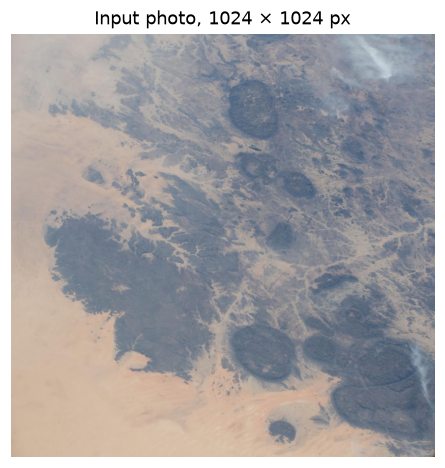

The model is never told where this photo was taken. We know the true answer (18.44° N, 9.10° E) only to score the result.

## 1. Shrink

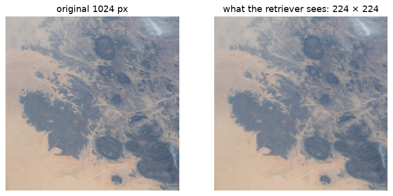

**What it does:** shrinks the photo to 224 × 224, the size the model expects.

**Here:** fine detail is lost, but the overall pattern of dark rock and sand survives, which is all the next step needs.

## 2. Fingerprint

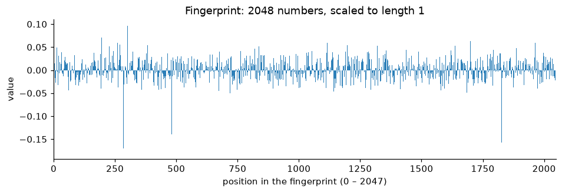

**What it does:** the AI model (AstroLoc) turns the photo into a list of 2,048 numbers. Photos and map tiles of the same place get similar lists.

**Here:** the numbers mean nothing on their own; they are only useful for comparing against other fingerprints.

## 3. Search

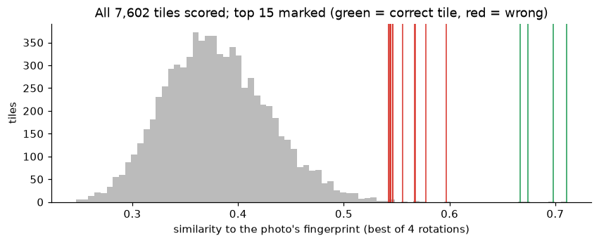

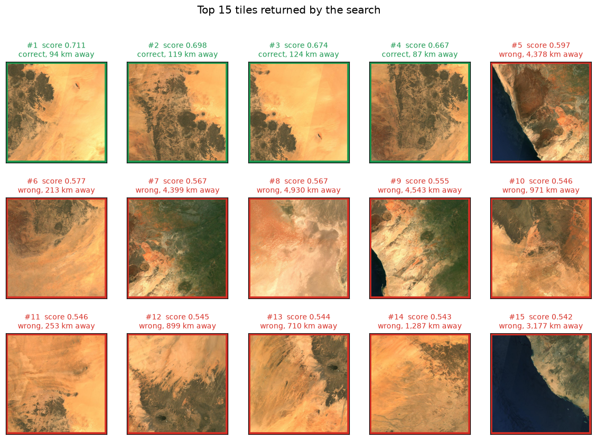

**What it does:** compares the fingerprint with the stored fingerprints of 7,602 map tiles covering the whole Earth, and keeps the 15 closest.

**Here:**
- The top 4 tiles are the right place (green); the other 11 are wrong (red).
- Each tile is ~300 km wide, so "the photo is somewhere in tile #1" is still **94 km off**. The next steps narrow it down.

## 4. Find points

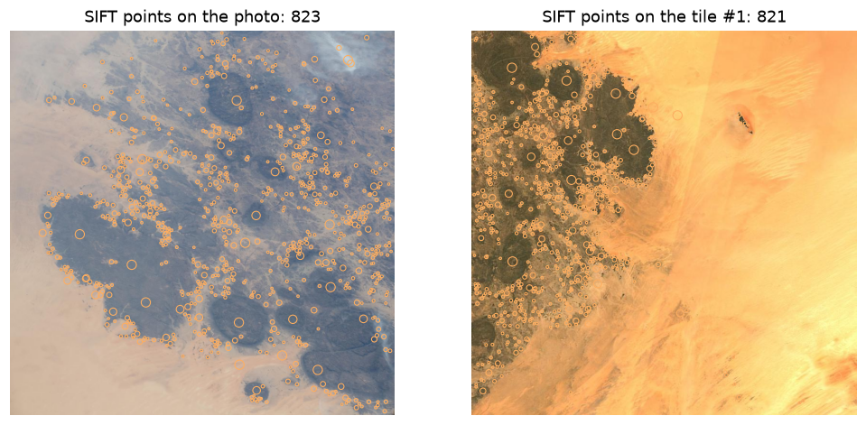

**What it does:** marks distinctive spots, such as rock edges and corners, in the photo and in each of the 15 tiles (method: SIFT).

**Here:** 823 points on the photo, 821 on tile #1. The tiles' points are computed ahead of time and stored, which saves time.

## 5. Pair points

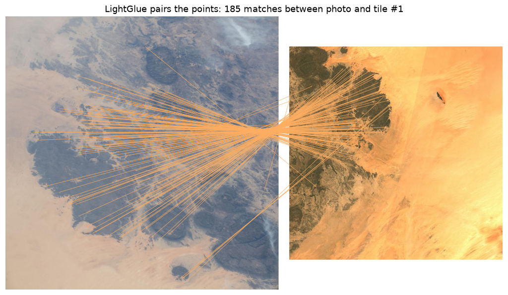

**What it does:** a second AI model (LightGlue) pairs each photo point with the tile point it most likely is.

**Here:**
- 185 pairs with tile #1.
- The lines cross because the photo is rotated compared with the north-up map.
- Repeating this for all 15 tiles takes most of the 1.3 s.

## 6. Check geometry

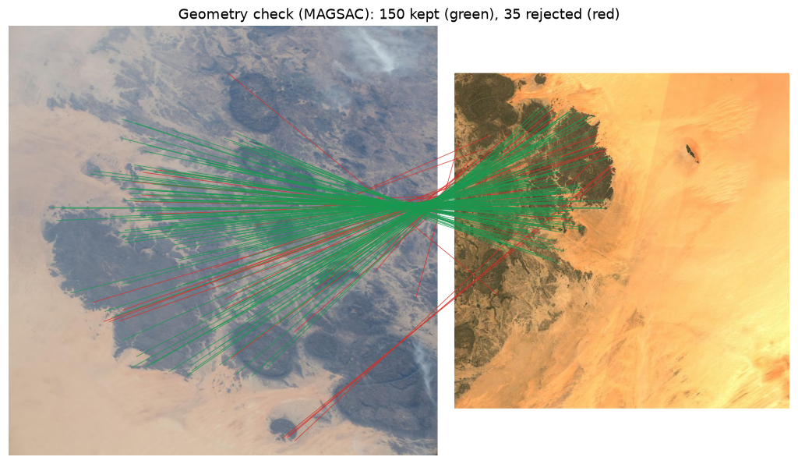

**What it does:** keeps only the pairs that agree with one consistent view of the ground, and throws out the rest as mismatches (method: MAGSAC).

**Here:** 150 pairs kept (green), 35 thrown out (red).

## 7. Decide

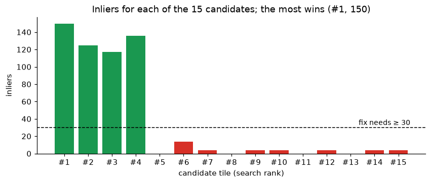

**What it does:** the tile with the most kept pairs wins. It counts as a **fix** only with at least 30; otherwise the answer is "no fix" rather than a guess.

**Here:**
- The 4 right tiles get 117–150 pairs; every wrong tile gets 14 or fewer.
- Tile #1 wins with 150, so this is a fix.

## 8. Locate

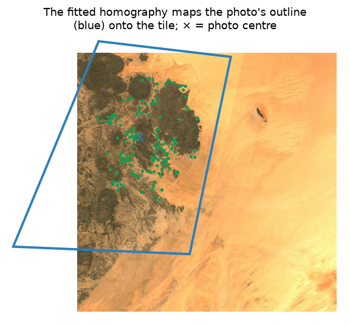

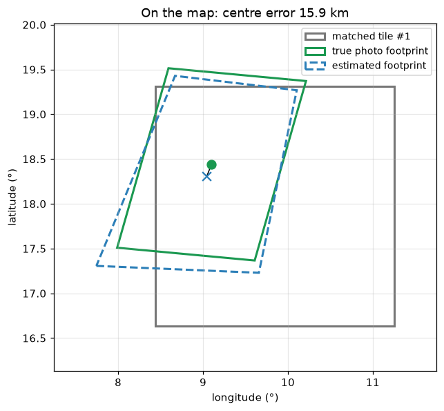

**What it does:** uses the kept pairs to place the photo's outline on the tile (blue). Because the tile's map coordinates are known, that gives the photo's position.

**Here:** estimated centre 18.31° N, 9.04° E against the true 18.44° N, 9.10° E. **Error: 15.9 km**, down from 94 km after the search alone.

## 9. Hand to OD

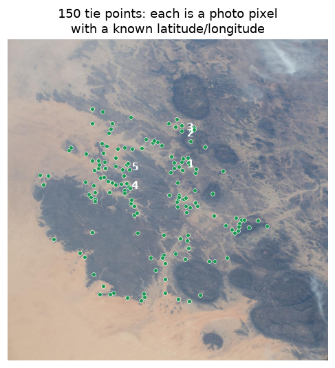

**What it does:** turns each kept pair into a "tie point": a pixel in the photo with its known latitude and longitude. Orbit determination (OD) uses many of these, over many photos, to work out the orbit.

**Here:** 150 tie points. The first five:

| # | Pixel in photo | Latitude, longitude |
|---|---|---|
| 1 | 557, 390 | 18.20° N, 8.96° E |
| 2 | 555, 292 | 17.98° N, 8.89° E |
| 3 | 555, 273 | 17.94° N, 8.87° E |
| 4 | 379, 459 | 18.32° N, 9.29° E |
| 5 | 380, 400 | 18.20° N, 9.26° E |

> **Not done yet:** feeding these into the OD solver. That step also needs the camera's details and pointing, and the time each photo was taken.

---

## When it goes wrong

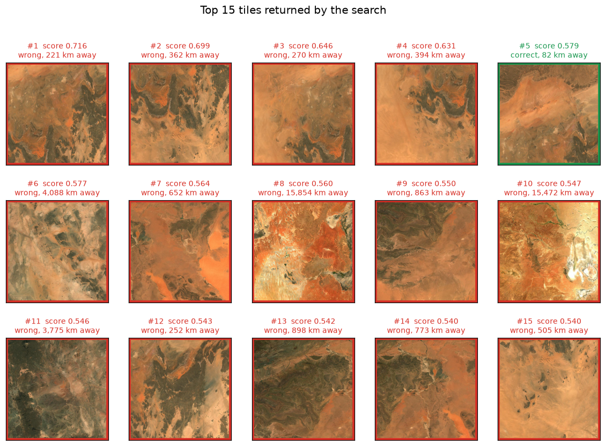

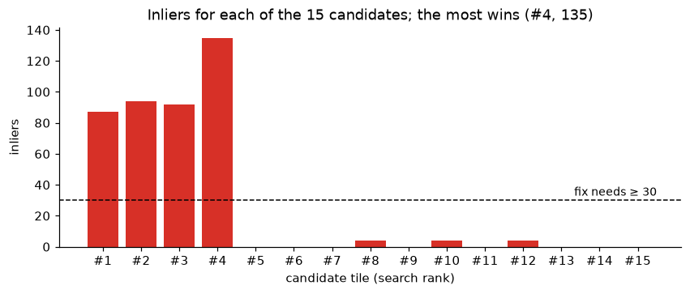

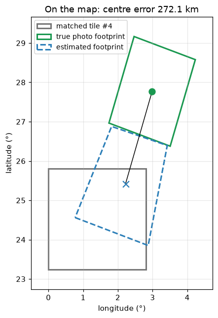

This is the worst of the 4 bad fixes in the 200-photo test.

- **Search:** the top 4 tiles are the wrong place, 220–390 km away. The right tile comes 5th.
- **Pairing:** the wrong tiles still get 87–135 good pairs; the right tile gets 0.
- **Result:** a confident fix that is **272 km off**. Its pair count (135) looks just like a good fix, so nothing flags it.
- **Why:** either that ground genuinely looks like the photo, or the photo's recorded location is wrong. We can't tell yet.
- **Why it matters:** OD would receive 135 tie points that all agree with each other and are all wrong. Bad fixes like this need to be caught before OD.

---

## Files

- **Figures:** `pipeline_walkthrough/`
- **Raw data for both photos:** `pipeline_walkthrough/data/` — photo, the 15 tiles, tie points (CSV), all numbers
- **Scripts:** `pipeline_trace.py` records each stage on the Jetson; `visualize_trace.py` draws the figures. Commands are in `RUNBOOK.md`.
